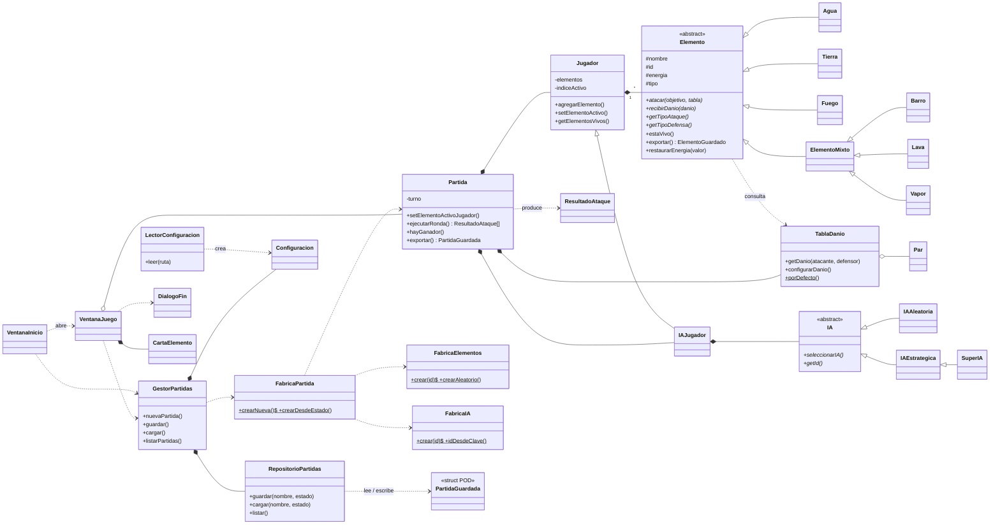

# Documento de diseño — Tercera Entrega

> Para entregar en .pdf/.docx: abrir este archivo y exportarlo (el diagrama está en Mermaid;
> se puede pegar en https://mermaid.live y exportar como imagen).

## 1. Diagrama de clases



## 2. Modificaciones respecto a la versión anterior del repositorio
(Ajustar esta lista si la Segunda Entrega entregada difiere del repositorio.)

* **Se corrigieron errores de compilación**: paréntesis en `Jugador::setIndiceElementoActivo`,
  `const` faltante en `getIndiceElementoActivo`, y `ElementoMixto` abstracta por no implementar los virtuales de archivo.
* **Configuración externa**: la tabla de daño, la cantidad de elementos y el tipo de IA ya no están fijos en
  el código (`Partida::iniciar()` y `inicio.cpp`); se leen de `config.txt`.
* **Persistencia reescrita**: antes `Elemento::guardar(ostream)` y `Partida::guardar()` escribían texto directamente.
  Ahora el dominio solo se convierte a structs y una única clase (`RepositorioPartidas`) toca el disco.
  Se guarda además tipo de IA, turno, nombre y elemento activo, y se pueden listar y cargar partidas.
* **Sin `switch` ni cadenas de `if`**: `FabricaElementos` y `FabricaIA` usan registros (`std::map` de constructores);
  `LectorConfiguracion` despacha directivas con un mapa; `TiposElemento` convierte tipo↔texto con una tabla.
* **Elementos mixtos completos** (Barro, Lava, Vapor) sin punteros: cada uno solo declara su tipo de ataque y de defensa.
* **Reglas**: un elemento eliminado ya no contraataca (como en el ejemplo del enunciado); se inicializa `srand`
  (antes todas las partidas repartían lo mismo); `Partida` libera a sus jugadores (había pérdidas de memoria).
* **Tabla por defecto**: `Tierra → Agua` pasó de 20 a 50, según el ejemplo del enunciado ("tierra reduce la vida del agua en un 50%").
  Con 20 el Agua le ganaba a todo y la IA estratégica no tenía sentido. Es solo un valor de `config.txt`.
* **Interfaz**: se reemplazó la pantalla única por tres pantallas (inicio, juego, fin), con barras de energía,
  registro de cada enfrentamiento, marca de elemento fuera de combate, guardar (botón, menú y Ctrl+S) y cargar.
  La UI se construye en código (se eliminaron los `.ui`) y solo habla con `Partida` y `GestorPartidas`.

## 3. Manejo de archivos y estructura de persistencia

**Configuración** (`config.txt`, texto): `LectorConfiguracion` → `Configuracion`. Sin archivo → valores por defecto;
línea inválida → se ignora y queda registrada como advertencia que muestra la pantalla de inicio.

**Partidas** (`partidas/*.sav`, binario). Flujo exigido por la cátedra:

```
GUARDAR:  Partida --exportar()--> PartidaGuardada (struct) --RepositorioPartidas.guardar()--> archivo
CARGAR:   archivo --RepositorioPartidas.cargar()--> PartidaGuardada (struct) --FabricaPartida.crearDesdeEstado()--> Partida
```

```cpp
struct ElementoGuardado { int id; float energia; };
struct PartidaGuardada {
    int magic, version;                 // "TPOO" y versión del formato
    char nombreJugador[32];
    int idIA, turno;
    int cantidadJugador; ElementoGuardado jugador[16]; int activoJugador;
    int cantidadIA;      ElementoGuardado ia[16];      int activoIA;
};
```
Los structs son planos a propósito (sin `std::string` ni punteros) para escribirse como un único bloque binario.
Al cargar se valida: tamaño del archivo, `magic`, versión, cantidades e índices en rango, e ids de elemento/IA conocidos
(los reconstruye `FabricaElementos` / `FabricaIA`, por eso los mixtos se restauran sin condicionales).
Los nombres de partida se sanitizan (solo letras, números, `_` y `-`) para impedir rutas como `../x`.

## 4. Justificación de las decisiones de diseño

* **Capas con dependencia en un solo sentido** (`ui → aplicacion → persistencia → modelo`). `modelo/` no incluye Qt
  ni `fstream`; se puede probar por consola (`pruebas/`). Cumple "lógica, persistencia e interfaz desacopladas".
* **Polimorfismo en lugar de condicionales**: el daño no se decide con `if`; cada elemento informa su tipo de ataque y de
  defensa y `TablaDanio` resuelve el resto. Un mixto solo sobrescribe `getTipoDefensa()`. Cada IA es una clase distinta
  y `IAJugador` la compone (patrón Strategy).
* **Registros en las fábricas** (patrón Factory + registro): agregar un elemento o una IA nueva es registrar una línea,
  sin tocar el código que la usa (abierto/cerrado).
* **Responsabilidad única**: `Partida` solo conoce las reglas; `GestorPartidas` coordina; `RepositorioPartidas` es la única clase
  que lee/escribe partidas; `LectorConfiguracion` la única que lee la configuración. No hay una clase "dios".
* **Encapsulamiento**: atributos privados/protegidos con getters; `Elemento` no es instanciable directamente (constructor
  protegido). Los únicos `struct` son los de persistencia (formato de disco), documentados como tales.
* **Propiedad de la memoria clara**: `Partida` posee a los jugadores, `Jugador` a sus elementos, `IAJugador` a su IA y
  `VentanaJuego` a la `Partida`. La construcción de partidas usa `unique_ptr` para no perder memoria si la carga falla.
* **Resultados como objetos** (`ResultadoAtaque`): la UI muestra quién atacó, cuánto daño hizo y si eliminó al rival
  sin que `Partida` conozca la interfaz (y sin `cout` en la lógica).

## 5. Funcionalidades implementadas
Partida completa humano vs IA (Aleatoria, Estratégica, Super IA) hasta quedar sin elementos vivos · reparto aleatorio ·
daño configurable · elementos mixtos opcionales · barras de energía · registro de combate · indicación de elemento fuera de
combate · pantalla de fin con ganador y resumen · guardar (botón/menú/Ctrl+S) con mensaje de éxito o error · cargar y reanudar
· listar partidas guardadas · configuración externa tolerante a errores.

## 6. Pruebas realizadas
* `pruebas/pruebas.cpp`: 556 verificaciones (combate, mixtos, fábricas, configuración válida/ausente/inválida,
  persistencia ida y vuelta, archivos corruptos, 150 partidas completas contra las 3 IAs).
* Prueba automatizada de la interfaz (modo offscreen): nueva partida → atacar → guardar → jugar hasta el final → pantalla final
  → cargar → archivo corrupto.
